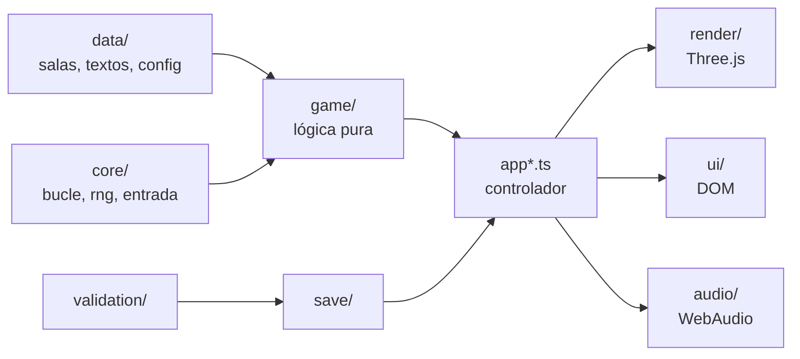

# Arquitectura

Cerrojo es un sitio estático: HTML, CSS y un único paquete de JavaScript generado con Vite a partir de TypeScript estricto. Three.js dibuja la escena; todo lo demás (colisión, puzzles, pistas, guardado, controles táctiles y sonido) es código propio. No hay servidor, ni cuentas, ni recursos externos: la geometría, las texturas y el sonido se generan por código al cargar cada sala.

La idea central es separar la **lógica** (qué pasa en la partida) de la **presentación** (cómo se ve y cómo suena). La lógica es TypeScript puro, sin Three.js ni DOM, y por eso se puede probar entera con tests rápidos y deterministas.

## Mapa de carpetas

```
src/
  main.ts            arranque: valida la URL y el guardado, crea la semilla y lanza la app
  app.ts             controlador: une lógica, render e interfaz, y ejecuta el bucle
  app-ui.ts          construye la interfaz y enlaza sus eventos con el controlador
  app-play.ts        acciones dentro de la sala: interactuar, inventario, combinar, pistas
  app-progress.ts    sala y semilla en juego, partida guardada y marcas
  app-screens.ts     qué se ve en cada modo y cuándo se captura el puntero
  core/              bucle de paso fijo, generador con semilla, estado de entrada, errores
  data/              datos tipados: salas, formas, configuración, textos y título
  game/              lógica pura: estado de partida, puzzles, colisión, pistas, guardado de sesión
  validation/        único punto de entrada de datos externos (guardado y URL)
  save/              único acceso a localStorage
  render/            escena Three.js: sala, objetos, texturas por Canvas, resalte, vista de examen
  ui/                interfaz en DOM: HUD, inventario, paneles de cerradura, menús, controles táctiles
  audio/             sonido sintetizado con WebAudio
tests/               tests de la lógica, de las salas y de entradas hostiles
public/              favicon e imagen de portada
docs/                esta documentación, licencias y parámetros de depuración
```

## Capas y dependencias



- `game/`, `core/`, `validation/` y `data/` no importan Three.js ni tocan el DOM. Una regla de ESLint impide importar Three.js en esas carpetas.
- `render/`, `ui/` y `audio/` no cambian el estado de la partida: muestran lo que la lógica decide y le envían intenciones (moverse, interactuar, girar una rueda).
- Las dependencias van en una sola dirección, de los datos a la lógica y de la lógica a la presentación, sin ciclos.

## Flujo de ejecución

1. `main.ts` lee los parámetros de la URL y el guardado, los valida en `validation/` y crea una semilla con `crypto.getRandomValues`.
2. `App` construye la vista (`render/game-view.ts`), la interfaz y el mundo de juego (`game/world.ts`) de la sala elegida.
3. Cada frame, el bucle de `core/loop.ts` avanza la lógica en pasos fijos de 1/60 s. El orden de los sistemas de cada paso (entrada, movimiento con colisión, objeto señalado, cronómetro, señales) está declarado en un solo lugar, `World`.
4. El render dibuja a la frecuencia de la pantalla e interpola la posición del jugador entre el paso anterior y el actual. El giro de la cámara se aplica en cada frame para que no tenga retraso.
5. Las acciones del jugador (interactuar, colocar, combinar, introducir un código) pasan por `GameState`, que decide el resultado. El resultado produce una señal (`game/signals.ts`) que la presentación convierte en un sonido y en su equivalente visual.

El jugador es un círculo que se mueve en el plano contra los rectángulos de paredes y muebles, deslizándose por ellos. El objeto señalado se elige con un rayo 3D contra las cajas de los objetos interactuables, con oclusión por paredes y muebles y un alcance máximo.

## Una sala como datos

Cada sala es un archivo en `src/data/rooms/` con un objeto `RoomDef` (`game/room.ts`): medidas, muebles, lámparas, objetos interactuables, objetos de inventario, pistas y puzzles. Cada puzzle declara su tipo y lo que necesita (objetos, pistas u otros puzzles resueltos); el registro de tipos está en `game/puzzles/index.ts`.

Tipos de puzzle: cerradura de llave u objeto (`key-lock`), ruedas de números (`code-lock`), diales (`dial`), símbolos (`symbol-lock`), interruptores en orden (`sequence`), huecos donde encajar piezas (`placement`) y combinación de objetos (`combine`).

La vista 3D se construye desde los mismos datos (`render/room-view.ts` y los módulos `render/props*.ts`), así que la sala que se valida y la que se ve son la misma.

## Respuestas por semilla

Las salas están hechas a mano, pero las respuestas no son fijas. `game/seeded.ts` deriva de la semilla de la partida la respuesta de cada puzzle con ruedas, diales, símbolos o interruptores, y lo que muestran las pistas que llevan a ella. Toda la aleatoriedad pasa por `core/rng.ts`, un generador determinista: la misma semilla da siempre las mismas respuestas, y nada en la lógica usa `Math.random` ni la hora del sistema. «Repetir» empieza con una semilla nueva.

## Toda partida tiene solución

Que una sala no pueda quedar bloqueada se comprueba con tests en tres niveles:

- **Validación estática** (`game/validate-room.ts`): referencias correctas, sin ciclos, cada objeto se consigue de un solo modo y lo gasta un solo puzzle, el inventario nunca se llena, cada pista se puede ver antes del puzzle que la necesita y la salida es alcanzable.
- **Resolvedor** (`game/solver.ts`): juega cada sala como una persona, usando solo lo que tiene a la vista y deduciendo los códigos de las pistas examinadas. Los tests lo ejecutan con 1000 semillas por sala.
- **Sin ambigüedad:** las pistas de cada partida llevan exactamente a la respuesta de su puzzle.

Además, equivocarse nunca gasta ni pierde nada: una pieza que no encaja vuelve al inventario y un código erróneo no cambia el estado.

## Guardado

Todo lo que se guarda es un único objeto JSON en `localStorage`, bajo la clave `cerrojo:v1`, con un campo de versión y migración de los formatos anteriores. Solo `save/` accede a `localStorage`, y todo lo leído cruza `validation/`: campo por campo, por lista blanca, con límites de tamaño, de rango y de cantidad. Los valores ausentes o inválidos toman su valor por defecto.

La partida en curso no se guarda como un estado, sino como un registro de las acciones acertadas. Al continuar, el registro se repite con la lógica real y después el resolvedor comprueba que la sala sigue teniendo solución. Si una acción no es legal o la sala no se puede terminar, la partida se descarta y se avisa. Así, un guardado manipulado nunca produce un estado imposible.

Si el navegador no deja guardar (bloqueado o sin espacio), el juego sigue y avisa una vez.

## Interfaz y entrada

La interfaz (HUD, inventario, paneles de cerradura, pistas y menús) es DOM normal, creado con nodos y `textContent`, nunca con HTML en texto. Los textos visibles están en `src/data/texts.ts` y el título en `src/data/meta.ts`.

Teclado, ratón y táctil se traducen en `ui/input-binding.ts` a las mismas intenciones; la traducción en sí (`ui/input-map.ts`) es pura y tiene tests. La lógica no sabe de qué dispositivo viene cada acción.

## Rendimiento

- Hay una sola sala cargada a la vez. Al cambiar de sala se liberan geometrías, materiales y texturas de la anterior.
- Tres niveles de calidad. Baja: texturas de 256 px, sin sombras y densidad de píxeles 1 (si el juego arranca en Baja, también sin antialiasing). Media: texturas de 512 px y densidad hasta 1,5. Alta: además, sombras de la lámpara principal y densidad hasta 2.
- Las sombras no se recalculan en cada frame, solo cuando algo de la sala cambia o se mueve.
- Cada sala tiene como mucho cuatro luces reales; las bombillas y las pantallas que brillan son materiales emisivos.

## Cómo se prueba

`npm run test` ejecuta los tests de Vitest de la carpeta `tests/`: cada tipo de puzzle, inventario, interacción (alcance y línea de visión), colisión, bucle de paso fijo, generador con semilla, pistas, señales, modos, guardado y migración, validación estática, resolvedor y ausencia de ambigüedad de cada sala, más entradas hostiles (guardados vacíos, gigantes, con tipos erróneos, con `__proto__`, fuera de rango, y parámetros de URL inválidos).

El render, el audio y los eventos reales del navegador no tienen tests automáticos; se prueban jugando.

## Cómo se extiende

- **Una sala nueva:** un archivo en `src/data/rooms/`, añadido en orden en `src/data/rooms/index.ts`, más sus textos. Los tests de salas la validan y la resuelven con 1000 semillas sin escribir nada más.
- **Un tipo de puzzle nuevo:** un módulo en `game/puzzles/` registrado en `game/puzzles/index.ts`, con su derivación en `game/seeded.ts`, su parte en el resolvedor, su panel en `ui/` si lo necesita y sus tests.
- **Un cambio en el formato guardado:** sube la versión y añade la migración en `validation/save-data.ts`.

## Seguridad

El juego trata como no fiable todo lo que viene de fuera: el guardado (que el jugador puede editar) y los parámetros de la URL. Ambos se validan en un único punto antes de llegar a la lógica. La página declara una política de seguridad de contenido en un `<meta>` que solo permite scripts y estilos del propio sitio y ninguna conexión a otros dominios. GitHub Pages no permite configurar cabeceras HTTP, así que no hay protecciones que solo existen como cabecera, como `frame-ancestors`.

El juego está pensado para funcionar también dentro de un iframe del mismo origen. En ese caso, el iframe no aísla al juego de la página que lo contiene.

## Límites conocidos

- Sin pantalla completa: dentro de un iframe con `sandbox` no está permitida.
- La captura del puntero depende del navegador. Si se rechaza, se puede mirar con las flechas o reintentar con un clic.
- El paquete pesa unos 720 kB (unos 190 kB comprimido), casi todo de Three.js.
- Los datos guardados viven solo en un navegador; no se sincronizan entre dispositivos.
